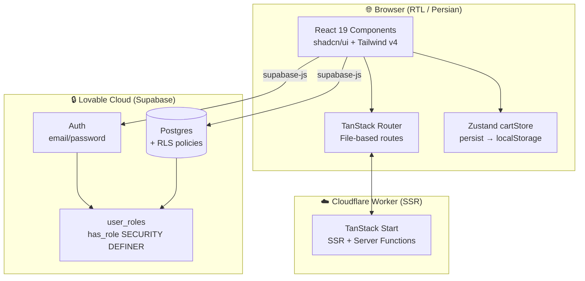
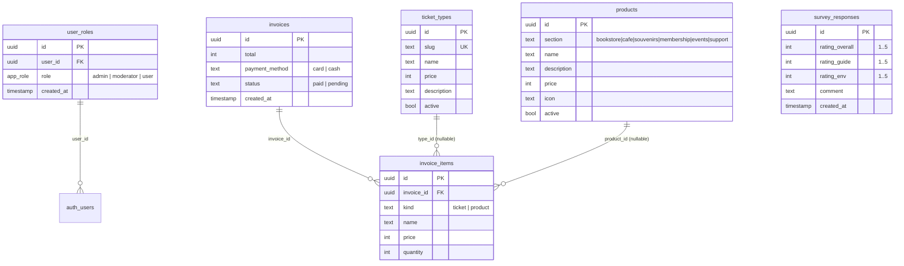
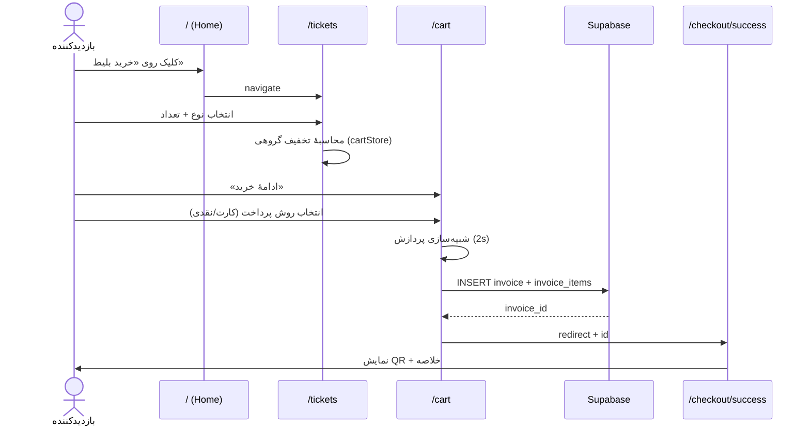
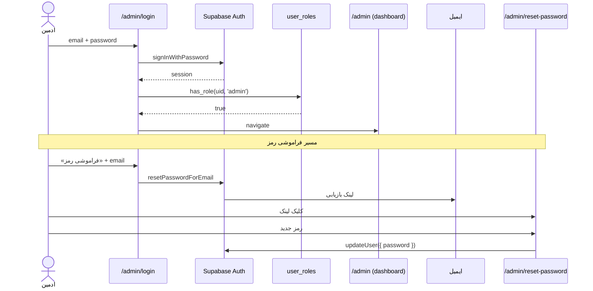
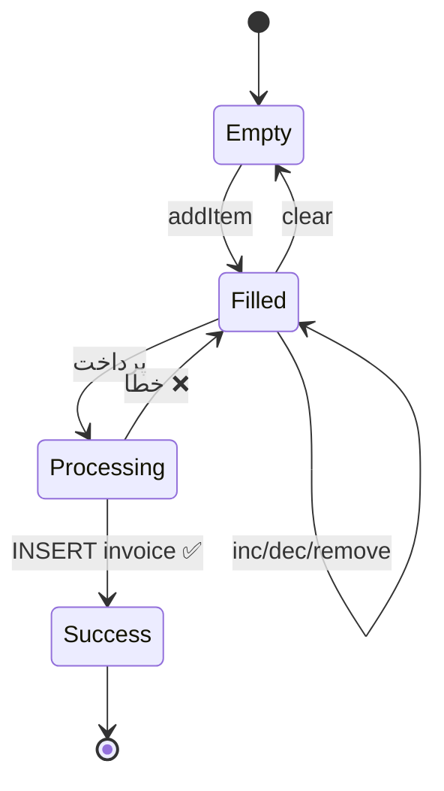
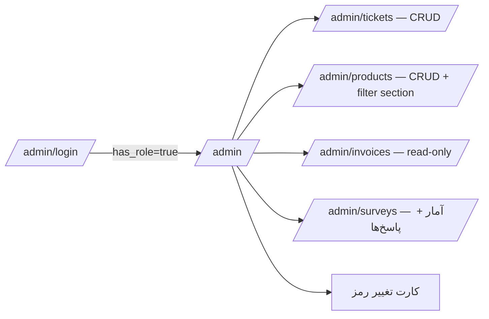
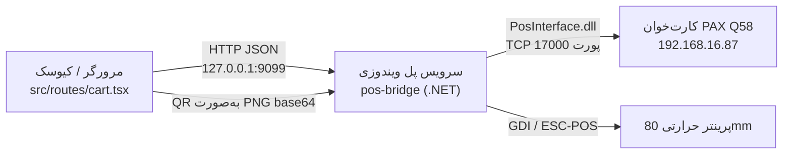
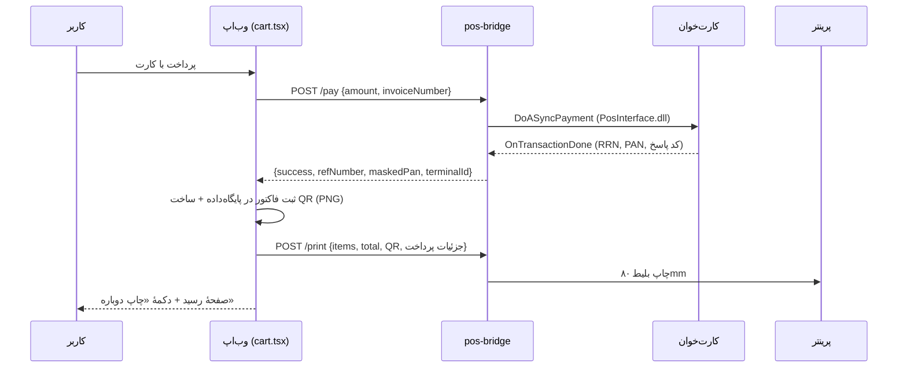

# موزه افتخارات کشتی ایران — Iran Wrestling Museum

پلتفرم رسمی فروش بلیط، فروشگاه‌های جانبی، نظرسنجی و پنل مدیریت موزهٔ افتخارات کشتی. رابط کاربری کاملاً فارسی/راست‌چین با تم موزه‌ای (Museum Navy + Bronze).

> **Status:** MVP در حال توسعه — پرداخت شبیه‌سازی‌شده، دیتابیس واقعی، ادمین کامل.
> **Language:** UI فارسی (RTL) — این README دوزبانه است.

---

## 1. Overview / معرفی

| | |
|---|---|
| **Product** | فروش آنلاین بلیط و محصولات موزه + جمع‌آوری نظرات بازدیدکنندگان |
| **Users** | بازدیدکنندگان موزه (عمومی) + ادمین (کارکنان موزه) |
| **Frontend** | TanStack Start v1 + React 19 + Vite 7 + Tailwind v4 |
| **Backend** | Lovable Cloud (Supabase — Postgres + Auth + RLS) |
| **State** | Zustand (سبد خرید با persist در localStorage) |
| **UI Kit** | shadcn/ui + lucide-react + Vazirmatn font |
| **Runtime** | Cloudflare Workers (Edge) |

### قابلیت‌های فعلی

- 🎫 خرید بلیط سه‌سطحی (عادی / راهنما / VIP) با **تخفیف گروهی** خودکار
- 🛒 سبد خرید persisted + پرداخت شبیه‌سازی‌شده + صفحهٔ موفقیت با **QR فاکتور**
- 🏪 شش فروشگاه پویا از دیتابیس: کتاب، کافه، یادبود، عضویت سالانه، رویدادها، حمایت
- ❤️ فرم **نظرسنجی** (امتیاز کلی + راهنما + محیط + پیام)
- 🔐 پنل ادمین کامل: داشبورد، مدیریت بلیط‌ها/محصولات/فاکتورها/نظرسنجی‌ها + تغییر رمز + بازیابی ایمیلی

---

## 2. System Architecture



---

## 3. Tech Stack

| Layer | Choice | Why |
|---|---|---|
| Framework | **TanStack Start v1** | SSR + file-based routes + type-safe navigation |
| Build | **Vite 7** | fast HMR, Lightning CSS |
| UI | **React 19** + **shadcn/ui** | modern, accessible, unstyled primitives |
| Styling | **Tailwind v4** (via `src/styles.css`) | design tokens + `@theme` |
| Icons | **lucide-react** | tree-shakeable |
| Font | **Vazirmatn** | فونت فارسی حرفه‌ای |
| State | **Zustand** (persist) | سبک، بدون boilerplate |
| Backend | **Supabase** (Lovable Cloud) | Postgres + Auth + Realtime + RLS |
| QR | **qrcode.react** | صفحهٔ موفقیت پرداخت |

---

## 4. Folder Structure

```text
src/
├── routes/                    # File-based routes (TanStack)
│   ├── __root.tsx             # HTML shell, lang="fa" dir="rtl"
│   ├── index.tsx              # 🏠 صفحهٔ اصلی (hero + tiles)
│   ├── tickets.tsx            # 🎫 انتخاب بلیط + تخفیف گروهی
│   ├── cart.tsx               # 🛒 سبد + پرداخت شبیه‌سازی
│   ├── checkout.success.tsx   # ✅ QR + خلاصهٔ فاکتور
│   ├── bookstore.tsx          # 📚 فروشگاه کتاب
│   ├── cafe.tsx               # ☕ کافه
│   ├── souvenirs.tsx          # 🏅 یادبود
│   ├── membership.tsx         # 💎 عضویت سالانه
│   ├── events.tsx             # 🏰 رویدادها
│   ├── support.tsx            # ❤️ حمایت + نظرسنجی
│   ├── admin.tsx              # 🔐 layout ادمین + گارد نقش
│   ├── admin.login.tsx        # ورود ادمین
│   ├── admin.reset-password.tsx  # بازنشانی رمز از لینک ایمیل
│   ├── admin.index.tsx        # داشبورد + کارت تغییر رمز
│   ├── admin.tickets.tsx      # CRUD بلیط‌ها
│   ├── admin.products.tsx     # CRUD محصولات (همهٔ بخش‌ها)
│   ├── admin.invoices.tsx     # لیست فاکتورها
│   └── admin.surveys.tsx      # آمار + پاسخ‌های نظرسنجی
├── components/
│   ├── PageShell.tsx          # layout مشترک صفحات عمومی
│   ├── SectionShopPage.tsx    # کامپوننت فروشگاه (استفادهٔ ۶ بخش)
│   ├── ComingSoonPage.tsx     # placeholder
│   └── ui/                    # shadcn primitives
├── store/
│   └── cartStore.ts           # Zustand + persist + منطق تخفیف
├── lib/
│   ├── ticketData.ts          # نوع/قیمت بلیط + محاسبهٔ تخفیف
│   └── utils.ts               # cn() و ...
├── integrations/supabase/     # ⚠️ auto-generated — دست نزنید
│   ├── client.ts              # supabase browser client
│   ├── client.server.ts       # admin client (server only)
│   ├── auth-middleware.ts     # requireSupabaseAuth
│   ├── auth-attacher.ts       # bearer برای serverFn
│   └── types.ts               # types از schema
├── assets/                    # تصاویر AI-generated
├── styles.css                 # ⚡ همهٔ توکن‌ها اینجا
├── router.tsx                 # QueryClient + Router setup
└── start.ts                   # middleware config
supabase/migrations/           # ⚠️ فقط از طریق ابزار migration
```

---

## 5. Data Model (ERD)



### RLS خلاصه

| Table | anon | authenticated | admin | notes |
|---|---|---|---|---|
| `ticket_types` | SELECT | SELECT | ALL | فقط فعال‌ها در UI |
| `products` | SELECT (active) | SELECT | ALL | فیلتر `active=true` |
| `invoices` / `invoice_items` | INSERT | INSERT | SELECT ALL | مشتری فقط می‌سازد |
| `survey_responses` | INSERT | INSERT | SELECT / DELETE | ناشناس اجازهٔ ثبت دارد |
| `user_roles` | — | SELECT خودش | ALL | چک با `has_role()` SECURITY DEFINER |

> **قانون طلایی:** هر `CREATE TABLE public.x` باید در همان migration با `GRANT`، `ENABLE RLS` و `CREATE POLICY` همراه باشد — وگرنه PostgREST خطای permission برمی‌گرداند.

---

## 6. User Flows

### 6.1 خرید بلیط



### 6.2 خرید محصول از فروشگاه‌ها

```mermaid
flowchart LR
  A[Home tile] --> B{Section route}
  B -->|/bookstore, /cafe, ...| C[SectionShopPage]
  C -->|SELECT products WHERE section=?| DB[(Supabase)]
  DB --> C
  C -->|addToCart| Z[Zustand cartStore]
  Z -->|persist| LS[localStorage]
  C --> D[/cart]
```

### 6.3 نظرسنجی

```mermaid
flowchart TD
  A[/support] --> B[فرم ۳ امتیاز + پیام]
  B --> V{اعتبارسنجی}
  V -->|OK| I[INSERT survey_responses]
  V -->|Error| B
  I --> T[toast موفقیت]
  I --> R[reset form]
```

### 6.4 ورود ادمین + بازیابی رمز



### 6.5 وضعیت‌های سبد خرید



### 6.6 پنل ادمین



---

## 7. Routes Map

| Route | نوع | توضیح |
|---|---|---|
| `/` | Public | صفحهٔ اصلی: hero + شش کاشی + دکمهٔ چرخ‌دنده (ادمین) |
| `/tickets` | Public | انتخاب بلیط با تخفیف گروهی |
| `/cart` | Public | سبد خرید + پرداخت شبیه‌سازی |
| `/checkout/success` | Public | QR + خلاصهٔ فاکتور |
| `/bookstore` `/cafe` `/souvenirs` `/membership` `/events` `/support` | Public | فروشگاه/فرم نظرسنجی |
| `/admin/login` | Public | ورود ادمین |
| `/admin/reset-password` | Public | بازنشانی رمز از لینک ایمیل |
| `/admin` | Layout (protected) | گارد `has_role('admin')` |
| `/admin/` | Admin | داشبورد + تغییر رمز |
| `/admin/tickets` | Admin | CRUD بلیط‌ها |
| `/admin/products` | Admin | CRUD محصولات همهٔ بخش‌ها |
| `/admin/invoices` | Admin | لیست فاکتورها |
| `/admin/surveys` | Admin | آمار و پاسخ‌های نظرسنجی |

---

## 8. State Management (Zustand)

`src/store/cartStore.ts` تنها منبع حقیقت سبد است.

- **Persist:** ذخیره در `localStorage` — با رفرش از دست نمی‌رود.
- **Actions:** `addTicket`, `addProduct`, `inc`, `dec`, `remove`, `clear`.
- **Selectors:** `getItemCount()`, `getSubtotal()`, `getDiscount()`, `getTotal()`.
- **تخفیف گروهی:** در `lib/ticketData.ts` — مثلاً ۵+ نفر ۱۰٪، ۱۰+ نفر ۱۵٪.

---

## 9. Auth & Roles

- ادمین پیش‌فرض: `daneshavaran2@gmail.com` / `123456789` (پس از اولین ورود در داشبورد عوض کنید).
- نقش‌ها **همیشه** در جدول جداگانهٔ `public.user_roles` — هرگز روی `profiles`.
- گارد سمت کلاینت با `supabase.rpc('has_role', {...})` — گارد سمت سرور همیشه با RLS.
- تابع `has_role` با `SECURITY DEFINER` و `SET search_path = public` تا recursion در policyها رخ ندهد.

---

## 10. Design System

پالت و توکن‌ها در `src/styles.css` (Tailwind v4 `@theme`):

| Token | Value | استفاده |
|---|---|---|
| `--museum-navy` | #03080f | پس‌زمینهٔ اصلی |
| `--bronze-gold` | linear-gradient(135deg, #f5c98a, #cd7f32 40%, #8b5a2b) | CTAs و عنوان‌ها |
| `--bronze-light` | #d9b48a | متن ثانویه |
| `.glass-bronze` | backdrop-blur + border برنزی | کارت‌های اصلی |
| `.text-bronze-gradient` | متن با gradient طلایی | تیترها |

**قواعد:**

- هرگز رنگ hex مستقیم در کامپوننت نگذارید — از توکن استفاده کنید.
- همهٔ صفحات RTL — به `space-x-reverse` و `text-right` توجه کنید.
- فونت پیش‌فرض Vazirmatn (در `__root.tsx` از Google Fonts لود می‌شود).

---

## 11. Local Development

```bash
# پیش‌نیاز: Bun ≥ 1.1
bun install
bun dev            # http://localhost:8080
bun run build      # SSR + client bundle
```

متغیرهای محیطی (`.env` — auto-generated توسط Lovable Cloud، دست نزنید):

```env
VITE_SUPABASE_URL=...
VITE_SUPABASE_PUBLISHABLE_KEY=sb_publishable_...
VITE_SUPABASE_PROJECT_ID=...
```

---

## 12. Database Migrations

- **هرگز** SQL را دستی روی دیتابیس نزنید — فقط از طریق ابزار migration Lovable.
- هر migration باید atomic باشد: `CREATE TABLE → GRANT → ENABLE RLS → CREATE POLICY`.
- فایل `src/integrations/supabase/types.ts` پس از هر migration خودکار تولید می‌شود.

مثال قالب:

```sql
CREATE TABLE public.my_table (id UUID PRIMARY KEY DEFAULT gen_random_uuid(), ...);
GRANT SELECT, INSERT, UPDATE, DELETE ON public.my_table TO authenticated;
GRANT ALL ON public.my_table TO service_role;
-- GRANT SELECT ON public.my_table TO anon;  -- فقط اگر خواندن عمومی می‌خواهید
ALTER TABLE public.my_table ENABLE ROW LEVEL SECURITY;
CREATE POLICY "..." ON public.my_table FOR SELECT USING (...);
```

---

## 13. Deployment

- **Publish:** از داخل Lovable (Publish button). خروجی به `project--<id>.lovable.app` می‌رود.
- **Custom domain:** از Settings → Domains قابل اتصال است.
- Runtime: Cloudflare Workers — کتابخانه‌های Node-only ممنوع (child_process, sharp, ...).

---

## 14. Extending — راهنمای توسعه‌دهنده

### افزودن یک بخش فروشگاه جدید (مثلاً «گالری هنر»)

1. یک ردیف در `products` با `section='gallery'` INSERT کنید (از `/admin/products`).
2. فایل `src/routes/gallery.tsx` بسازید:
   ```tsx
   import { createFileRoute } from "@tanstack/react-router";
   import SectionShopPage from "@/components/SectionShopPage";
   export const Route = createFileRoute("/gallery")({
     component: () => <SectionShopPage section="gallery" title="گالری هنر" />,
   });
   ```
3. کاشی جدید در `TILES` داخل `src/routes/index.tsx` اضافه کنید.

### افزودن یک جدول جدید

migration را با ابزار Lovable ثبت کنید — الگوی چهار‌مرحله‌ای بخش ۱۲ را رعایت کنید.

### افزودن فیلد به فرم نظرسنجی

1. migration: `ALTER TABLE survey_responses ADD COLUMN ...`.
2. `src/routes/support.tsx`: state + input + payload.
3. `src/routes/admin.surveys.tsx`: نمایش ستون جدید.

### افزودن یک route ادمین جدید

فایل را `src/routes/admin.<name>.tsx` نامگذاری کنید — به‌طور خودکار زیر layout `admin.tsx` (با گارد نقش) قرار می‌گیرد. اسم را در آرایهٔ `NAV` داخل `admin.tsx` اضافه کنید.

---

## 15. Security Notes

- ✅ RLS روی همهٔ جداول public فعال است.
- ✅ نقش‌ها در جدول جداگانه (جلوگیری از privilege escalation).
- ✅ صفحهٔ ورود ادمین هیچ اطلاعات پیش‌فرضی نمایش نمی‌دهد.
- ✅ `supabaseAdmin` (service role) فقط در فایل‌های `.server.ts` استفاده شود.
- ⚠️ پرداخت **شبیه‌سازی** است — قبل از production حتماً درگاه واقعی اضافه شود.
- ⚠️ `survey_responses` INSERT عمومی دارد — در صورت اسپم rate-limit اضافه شود.

---

## 16. Roadmap

- [ ] اتصال درگاه پرداخت واقعی (زرین‌پال / IDPay)
- [ ] دوزبانه‌سازی EN (i18n)
- [ ] ایمیل تراکنشی فاکتور (Resend / Custom Emails)
- [ ] تخفیف کد پروموشن
- [ ] گزارش‌گیری تحلیلی پیشرفته در داشبورد
- [ ] صف‌بندی ورود در ساعات شلوغ

---

## 17. Troubleshooting

| علامت | علت محتمل | راه‌حل |
|---|---|---|
| `permission denied for table X` | GRANT فراموش شده | migration اصلاحی با `GRANT ... TO ...` |
| ادمین 401 پس از ورود | نقش در `user_roles` نیست | ردیف با `role='admin'` اضافه کنید |
| محصولات نمایش داده نمی‌شوند | `active=false` یا section اشتباه | از `/admin/products` بررسی کنید |
| ایمیل بازیابی نمی‌رسد | دامنهٔ ایمیل تنظیم نیست | Cloud → Emails → افزودن دامنه |
| صفحهٔ سفید پس از navigation | `<Outlet />` در layout نیست | چک `admin.tsx` و `__root.tsx` |
| SSR crash با `localStorage` | خواندن در render | داخل `useEffect` منتقل کنید |

---

## License

مالکیت انحصاری — © فدراسیون کشتی جمهوری اسلامی ایران.

---

## 18. راهنمای کامل اجرا (Full Setup)

```bash
# 1) پیش‌نیاز: Bun ≥ 1.1 و Node ≥ 20
bun install

# 2) متغیرهای محیطی — فایل .env توسط Lovable Cloud خودکار ساخته می‌شود:
#    VITE_SUPABASE_URL / VITE_SUPABASE_PUBLISHABLE_KEY / VITE_SUPABASE_PROJECT_ID
#    (نسخهٔ بدون VITE_ برای سمت سرور) — این فایل را دستی ویرایش نکنید.

# 3) اجرا
bun dev                 # http://localhost:8080
bun run build           # بیلد SSR + client
```

**دیتابیس:** تمام schema در `supabase/migrations/` نگهداری می‌شود و فقط از طریق
ابزار migration داخل Lovable اجرا می‌شود. جزئیات جدول‌ها، RLS، کوئری هر جریان و
داده‌های نمونه در [`docs/DATABASE.md`](docs/DATABASE.md).

**حساب‌های تست (seed):** `test-user1@museum.local` / `test-mod@museum.local` /
`test-admin2@museum.local` — همه با رمز `Test@12345`.
ادمین اصلی: `daneshavaran2@gmail.com`.

**کیوسک ویندوزی:** مراحل چرخاندن صفحه، اجرای تمام‌صفحه، اجرای خودکار با ویندوز و
قفل‌کردن دستگاه در [`docs/KIOSK-WINDOWS.md`](docs/KIOSK-WINDOWS.md)؛
اسکریپت آماده: `scripts/launch-kiosk.bat`.

---

## 19. دیباگ و عیب‌یابی

### فعال‌سازی لاگ‌ها

| محل | چطور |
|---|---|
| مرورگر | DevTools → Console؛ خطاهای React/Supabase اینجا می‌آیند |
| شبکه | DevTools → Network → فیلتر `rest/v1` برای دیدن کوئری‌های دیتابیس |
| سرور (SSR) | خروجی ترمینال `bun dev` |
| دیتابیس | Cloud → Logs → Postgres / PostgREST |
| Auth | Cloud → Logs → Auth (برای خطاهای ورود و ایمیل بازیابی) |

لاگ موقت برای هر کوئری Supabase:

```ts
const { data, error } = await supabase.from("products").select("*");
if (error) console.error("[products]", error.message, error.details, error.hint);
```

### پیام‌های خطای رایج

| پیام | معنی | راه‌حل |
|---|---|---|
| `permission denied for table X` | GRANT داده نشده | migration اصلاحی با `GRANT ... TO anon/authenticated` |
| `new row violates row-level security policy` | policy مربوط به INSERT نیست یا شرط WITH CHECK رد شده | policy را بررسی کنید |
| `infinite recursion detected in policy` | policy جدول را به خودش ارجاع داده | استفاده از `has_role()` با `SECURITY DEFINER` |
| `JWT expired` | نشست منقضی شده | خروج و ورود مجدد ادمین |
| `Expected 3 parts in JWT; got 1` | کلید `sb_publishable_`/`sb_secret_` جای JWT رفته | از کلاینت‌های تولیدشدهٔ پروژه استفاده کنید |
| `Unsupported provider` | provider در Auth فعال نیست | فعال‌سازی provider در Cloud |
| `localStorage is not defined` | کد مرورگری در SSR اجرا شده | انتقال به `useEffect` |
| صفحهٔ سفید بعد از ناوبری | `<Outlet />` در layout نیست | `admin.tsx` و `__root.tsx` را چک کنید |

### چک‌لیست بررسی مشکلات

1. **UI خالی است؟** → Network را ببینید: کوئری ۲۰۰ برگشته ولی آرایه خالی است؟
   یعنی داده/فیلتر (`active=true`, `section`) مشکل دارد، نه کد.
2. **کوئری ۴۰۱/۴۰۳؟** → مشکل RLS یا GRANT است. با `psql` همان SELECT را بزنید؛
   اگر آنجا کار کرد، حتماً policy است.
3. **ادمین بعد از ورود بیرون می‌افتد؟** → در `user_roles` ردیف با `role='admin'`
   برای آن `user_id` وجود دارد؟ `select * from user_roles;`
4. **سبد خرید عجیب رفتار می‌کند؟** → `localStorage` را پاک کنید (کلید `cart-storage`).
5. **قیمت/تخفیف اشتباه؟** → `ticket_types.group_min_count` و
   `group_discount_percent` را در `/admin/tickets` بررسی کنید؛ منطق داده‌محور است.
6. **بیلد می‌شکند؟** → اغلب import کتابخانهٔ Node-only در سرور است
   (`child_process`, `sharp`)؛ روی Cloudflare Workers مجاز نیست.
7. **صفحه اسکرول می‌خورد (کیوسک)؟** → بخش no-scroll در `docs/KIOSK-WINDOWS.md`.

### کوئری‌های سریع بررسی سلامت

```sql
select count(*) from products where active;
select role, count(*) from user_roles group by role;
select status, count(*), sum(total) from invoices group by status;
select round(avg(overall_rating),2) from survey_responses;
```

## اتصال کارت‌خوان (PC-POS پارسیان)

پرداخت با دستگاه پوز از طریق یک «سرویس پل» ویندوزی انجام می‌شود، چون مرورگر نمی‌تواند
مستقیماً `pec.pcpos.dll` را فراخوانی کند.

```text
کیوسک (وب‌اپ)  --HTTP-->  PosBridge (127.0.0.1:9099)  --DLL-->  دستگاه پوز
```

- کد سرویس: پوشهٔ `pos-bridge/` (راهنمای نصب در `pos-bridge/README.md`).
- شمارهٔ ترمینال پیش‌فرض: `5634056`.
- تنظیم آدرس سرویس و شمارهٔ ترمینال و «تست اتصال» از پنل مدیریت → **کارت‌خوان** (`/admin/pos`).
- برای تست بدون دستگاه، در `pos-bridge/appsettings.json` مقدار `"simulate": true` را بگذارید.
- مبلغ همیشه به ریال (تومان × ۱۰) به دستگاه ارسال می‌شود.
- فاکتور فقط پس از پاسخ موفق دستگاه ثبت می‌شود؛ کد پیگیری (`pos_ref_number`)،
  شمارهٔ کارت ماسک‌شده (`pos_masked_pan`)، کد پاسخ و شمارهٔ ترمینال در جدول `invoices` ذخیره
  و در صفحهٔ رسید نمایش داده می‌شوند.
- اگر سرویس پل در دسترس نباشد (مثلاً در پیش‌نمایش مرورگر) پیام خطا نمایش داده می‌شود و
  امکان «پرداخت نقدی» باقی می‌ماند.

### نمایش مبالغ

همهٔ مبالغ از `src/lib/money.ts` قالب‌بندی می‌شوند: `formatToman` («۴۵٬۰۰۰ تومان») و
`formatTomanShort` («۱۰۰ هزار تومان»، «۱ میلیون تومان»). از نمادهایی مثل `k` استفاده نکنید.


## استقرار روی لیارا (Liara)

خطای «شاید پورتی که برنامه‌ی شما به آن listen می‌کند را اشتباه وارد کرده‌اید» یعنی سرویس روی `0.0.0.0` و پورت `PORT` بالا نیامده است. پروژه اکنون برای این حالت آماده است.

### مراحل

1. در پنل لیارا یک برنامه از نوع **Node.js** بسازید.
2. متغیرهای محیطی زیر را در بخش «متغیرها» ست کنید (مقادیر از فایل `.env` پروژه):
   - `VITE_SUPABASE_URL`
   - `VITE_SUPABASE_PUBLISHABLE_KEY`
   - `VITE_SUPABASE_PROJECT_ID`
   - `SUPABASE_URL`
   - `SUPABASE_PUBLISHABLE_KEY`
   - `NITRO_PRESET=node_server` (اختیاری؛ پیش‌فرض پروژه هم همین است)
   - `WINDOWS_DOWNLOAD_URL` (اختیاری؛ بخش «لینک دانلود نسخهٔ ویندوزی» پایین)
3. استقرار:
   ```bash
   npm install -g @liara/cli
   liara login
   liara deploy --app <نام-برنامه>
   ```

### چه چیزی تغییر کرد

- `vite.config.ts`: خروجی build با preset `node_server` ساخته می‌شود (به‌جای Cloudflare Worker) → فایل `.output/server/index.mjs`.
- `package.json`: اسکریپت `start` سرور را روی `0.0.0.0` و پورت `PORT` بالا می‌آورد:
  ```
  HOST=0.0.0.0 PORT=${PORT:-3000} node .output/server/index.mjs
  ```
- `liara.json`: پلتفرم Node 22، پورت 3000، منطقهٔ زمانی تهران و health check.
- `.liaraignore`: جلوگیری از آپلود `node_modules`، `.output` و `.env`.

> نکته: متغیرهای `VITE_*` در زمان **build** خوانده می‌شوند؛ اگر بعد از استقرار آن‌ها را تغییر دادید، باید دوباره `liara deploy` بزنید.

### لینک دانلود نسخهٔ ویندوزی

بعد از استقرار، نسخهٔ ویندوزی (`MuseumKiosk-Windows.zip`) از همین سرور دانلود می‌شود. دکمهٔ
«دانلود آخرین نسخه» در داشبورد پنل مدیریت هم به همین آدرس است:

```
https://<نام-برنامه>.liara.run/api/download/windows
```

این لینک ثابت است و همیشه آخرین نسخه را می‌دهد: سرور دانلود را به آخرین Release گیت‌هاب هدایت
می‌کند. برای دانلود سریع‌تر داخل ایران می‌توانید فایل را در فضای ذخیره‌سازی ابری لیارا (با دسترسی
عمومی) آپلود کنید و آدرس https آن را در متغیر `WINDOWS_DOWNLOAD_URL` بگذارید. این متغیر هنگام اجرا
خوانده می‌شود و `liara deploy` دوباره لازم ندارد؛ کافی است برنامه دوباره اجرا شود.

### کارت‌خوان روی دامنهٔ HTTPS

سرویس پل کارت‌خوان روی `http://127.0.0.1:9099` همان کیوسک اجرا می‌شود. چون صفحه روی HTTPS باز می‌شود، کروم درخواست HTTP به لوکال‌هاست را مسدود می‌کند؛ به همین دلیل در `scripts/launch-kiosk.bat` فلگ‌های زیر اضافه شده‌اند:

```
--unsafely-treat-insecure-origin-as-secure=http://127.0.0.1:9099
--allow-running-insecure-content
```

آدرس کیوسک را در متغیر `KIOSK_URL` همان فایل به دامنهٔ لیارا تغییر دهید.

---

## عیب‌یابی استقرار روی لیارا (Liara)

### ۱. بررسی سریع سلامت سرویس

```bash
curl -s https://<دامنهٔ-شما>/api/health | jq
```

خروجی نمونه:

```json
{
  "status": "ok",
  "app": "iran-wrestling-museum-kiosk",
  "time": "2026-08-24T11:00:00.000Z",
  "uptimeSeconds": 42,
  "nodeEnv": "production",
  "port": "3000",
  "host": "0.0.0.0",
  "db": "ok"
}
```

- `status: "degraded"` یا `db: "down"` → متغیرهای `SUPABASE_URL` و `SUPABASE_PUBLISHABLE_KEY` روی لیارا تنظیم نشده‌اند یا اشتباه‌اند.
- عدم پاسخ (timeout/502) → سرویس اصلاً بالا نیامده؛ لاگ‌ها را ببینید.

### ۲. مشاهدهٔ لاگ‌ها

```bash
liara logs --app <نام-برنامه> --follow
liara logs --app <نام-برنامه> --since 1h
```

هنگام بالا آمدن سرویس، این بلوک در لاگ چاپ می‌شود:

```
──────── راه‌اندازی سرور موزه کشتی ────────
HOST            : 0.0.0.0
PORT            : 3000
NODE_ENV        : production
NITRO_PRESET    : node_server
SUPABASE_URL    : ✔ تنظیم‌شده
SUPABASE_KEY    : ✔ تنظیم‌شده
سلامت سرویس     : GET /api/health
───────────────────────────────────────────
```

اگر این بلوک را نمی‌بینید یعنی هیچ درخواستی به سرور نرسیده یا build خراب است.

### ۳. خطای «پورت اشتباه / listen روی 0.0.0.0»

پیام لیارا:

> شاید پورتی که برنامه‌ی شما به آن listen می‌کند را اشتباه وارد کرده‌اید. لازم است برنامه حتماً روی 0.0.0.0 اجرا شود.

چک‌لیست:

| بررسی | دستور / محل | انتظار |
| --- | --- | --- |
| اسکریپت start | `package.json` | `HOST=0.0.0.0 PORT=${PORT:-3000} node .output/server/index.mjs` |
| preset بیلد | `vite.config.ts` | `node_server` (نه cloudflare) |
| وجود خروجی | بعد از build | فایل `.output/server/index.mjs` |
| پورت لیارا | `liara.json` | `"port": 3000` و همان مقدار در پنل |
| هشدار در لاگ | لاگ استارت | نبود پیام `[startup] هشدار: HOST ...` |

اگر در لاگ `[startup] هشدار: متغیر PORT تعریف نشده است` دیدید، مقدار `PORT` را در پنل لیارا ست کنید یا پورت برنامه را روی ۳۰۰۰ بگذارید.

### ۴. تست دود بعد از deploy

```bash
npm run smoke -- https://<دامنهٔ-شما>
```

این اسکریپت `/api/health` و صفحه‌های اصلی (بلیط، سبد، فروشگاه‌ها، نظرسنجی، ورود مدیریت و پیکربندی کارت‌خوان در حالت بدون دستگاه) را بررسی می‌کند و در صورت خطا با کد خروج غیرصفر تمام می‌شود — مناسب برای اجرا در CI بعد از deploy.

### ۵. خطاهای رایج

| نشانه | علت محتمل | راه‌حل |
| --- | --- | --- |
| ۵۰۲ روی همهٔ مسیرها | سرویس بالا نیامده / کرش در استارت | `liara logs` و بررسی خطای ماژول |
| `{"unhandled":true,"message":"HTTPError"}` | خطای SSR | لاگ سرور، همان خطا با stack چاپ می‌شود |
| صفحات باز می‌شوند ولی داده‌ای نیست | متغیرهای `VITE_SUPABASE_*` در زمان build نبوده‌اند | ست کردن متغیرها و `liara deploy` مجدد |
| پرداخت کارت‌خوان کار نمی‌کند | pos-bridge اجرا نشده یا مسدود شدن HTTP روی HTTPS | اجرای `pos-bridge` و فلگ‌های `launch-kiosk.bat` |
| `db: "down"` در health | متغیرهای سرور Supabase غلط | اصلاح `SUPABASE_URL` / `SUPABASE_PUBLISHABLE_KEY` |

---

## تست‌ها و CI

```bash
npm run test        # حالت watch
npm run test:run    # یک‌بار اجرا (CI)
npm run typecheck
npm run smoke -- https://<دامنهٔ-شما>
```

تست‌های `tests/pos-checkout.test.ts` جریان کامل پرداخت با کارت‌خوان را با یک **سرویس ماک pos-bridge** پوشش می‌دهند (بدون نیاز به دستگاه):
پرداخت موفق و ثبت فاکتور/اقلام/کد پیگیری، پاسخ ناموفق دستگاه، خطای HTTP، timeout، لغو توسط کاربر، در دسترس نبودن سرویس، و خطای ثبت فاکتور با وجود پرداخت موفق.

Workflow گیت‌هاب در `.github/workflows/ci.yml` مراحل lint → typecheck → test → build را روی هر push/PR اجرا می‌کند.

---

## نسخهٔ ویندوزی و اندرویدی

### ویندوز — برنامهٔ نصب‌شدنی (پیشنهادی)

نسخهٔ دسکتاپ مستقل (Electron) که بدون مرورگر و بدون آدرس اینترنتی اجرا می‌شود؛ فایل‌های برنامه داخل خودش است و روی `127.0.0.1` بالا می‌آید.

```bash
npm install --save-dev electron @electron/packager   # فقط بار اول
npm run desktop:package                              # خروجی: electron-release/
```

سپس روی کیوسک، `installers/install-windows.bat` را با **Run as administrator** اجرا کنید: نصب در `%LOCALAPPDATA%\MuseumKiosk`، ساخت میان‌بر با آیکون موزه، اجرای خودکار در استارتاپ و راه‌اندازی `pos-bridge`. خروج از کیوسک با `Ctrl+Shift+Q`.
جزئیات، به‌روزرسانی و عیب‌یابی: [`docs/WINDOWS-APP.md`](docs/WINDOWS-APP.md).

### ویندوز — حالت کیوسک مرورگری (جایگزین سبک)

1. `scripts/install-kiosk-windows.bat` را با **Run as administrator** اجرا کنید.
2. میان‌بر دسکتاپ و اجرای خودکار در استارتاپ ساخته می‌شود و در صورت وجود، `pos-bridge` هم به استارتاپ اضافه می‌گردد.
3. آدرس کیوسک را در `scripts/launch-kiosk.bat` (متغیر `KIOSK_URL`) روی دامنهٔ لیارا تنظیم کنید.

### اندروید (PWA/TWA)

راهنمای کامل ساخت APK/AAB با Bubblewrap و تنظیم `assetlinks.json` در `docs/ANDROID.md` آمده است؛ محدودیت کارت‌خوان روی اندروید هم همان‌جا توضیح داده شده.

---

## 20. اتصال واقعی کارت‌خوان (PosInterface.dll) و چاپ بلیط — مستند کامل

این بخش دقیقاً توضیح می‌دهد چه چیزی برای اتصال به دستگاه پز بانکی (PAX Q58) و چاپ بلیط روی پرینتر حرارتی پیاده‌سازی شده و **هر قطعه کجای کد است**.

### 20.1 معماری کلی



مرورگر مستقیماً به دستگاه پز وصل نمی‌شود؛ همه‌چیز از طریق سرویس پل ویندوزی (`pos-bridge`) روی همان رایانهٔ کیوسک انجام می‌شود.

### 20.2 اتصال به دستگاه پز — سمت ویندوز

| موضوع | فایل | توضیح |
|---|---|---|
| کتابخانهٔ رسمی بانک | `pos-bridge/lib/PosInterface.dll` | رفرنس مستقیم در `pos-bridge/PosBridge.csproj` |
| لایهٔ اتصال واقعی | `pos-bridge/PosNative.cs` | ساخت `new PCPos(posListenPort)` → `ListenPos(this)` → `InitLAN(ip)` یا `InitSerial(com, baud)` |
| نتیجهٔ تراکنش | `pos-bridge/PosNative.cs` → `OnTransactionDone(TransactionResult)` | پیاده‌سازی `ITransactionDoneHandler`؛ منتظر ماندن با `AutoResetEvent` تا سقف `timeoutSeconds` |
| ارسال فروش | `pos-bridge/PosNative.cs` → `Pay(...)` | `DoASyncPayment(amountRial, tashim, invoiceNumber, DateTime.Now, handler)` |
| استخراج فیلدها | `pos-bridge/PosNative.cs` → `Str(...)` | خواندن `ErrorCode`, `RRN`, `CardNumber`, `Stan`, `TerminalId` با Reflection (نام‌ها بین نسخه‌های SDK فرق دارد) |
| فالبک TCP و کشف دستگاه | `pos-bridge/PosDevice.cs` | اگر `useSdk=false` یا SDK پاسخ ندهد، پروتکل مستقیم TCP + `/discover` + بررسی شناسنامه |
| لاگ ساخت‌یافته | `pos-bridge/PosLog.cs` | مصرف‌شده در `/logs` و استریم زندهٔ `/events` (SSE) |
| تنظیمات | `pos-bridge/Config.cs` + `pos-bridge/appsettings.json` | `posListenPort` (۱۷۰۰۰)، `useSdk`، `deviceIp`، `connectionMode`، `merchantId`، `terminalId`، `serialNumber`، `printerName` … |

مسیرهای HTTP سرویس پل — همگی در `pos-bridge/Program.cs` (بلوک `switch` روی مسیر):

| مسیر | کار |
|---|---|
| `/health` | وضعیت سرویس و بارگذاری‌شدن کتابخانه |
| `/config` | خواندن/ذخیرهٔ تنظیمات (نیازمند `X-Pos-Token`) |
| `/discover` | اسکن شبکه و تطبیق شمارهٔ سریال/مدل/فریم‌ور |
| `/ping` | بررسی سلامت اتصال + RTT |
| `/pay` | شروع تراکنش (به `PosNative.Pay` می‌رسد) |
| `/cancel` | لغو تراکنش جاری و راه‌اندازی دوبارهٔ اتصال |
| `/logs`, `/events` | لاگ‌ها و استریم زنده (SSE) |
| `/printers`, `/print` | فهرست پرینترها و چاپ بلیط |

### 20.3 چاپ بلیط روی پرینتر حرارتی ۸۰ میلی‌متری

| موضوع | فایل | توضیح |
|---|---|---|
| موتور چاپ | `pos-bridge/Printer.cs` | `PrintDocument` (GDI) با `StringFormat` راست‌به‌چپ تا حروف فارسی درست چسبیده چاپ شوند |
| مدل دادهٔ بلیط | `pos-bridge/Printer.cs` → `TicketData` / `TicketLine` | نام موزه، شمارهٔ فاکتور، تاریخ شمسی، اقلام، مبلغ، RRN، کارت ماسک‌شده، QR |
| فهرست پرینترها | `pos-bridge/Printer.cs` → `ListPrinters()` / `DefaultPrinter()` | برای انتخاب پرینتر در پنل مدیریت |
| تصویر QR | در مرورگر ساخته می‌شود | `src/lib/receipt.ts` → `qrPngDataUrl()` (تبدیل `QRCodeSVG` به PNG base64) و در `Printer.cs` رمزگشایی و روی بلیط رسم می‌شود |

چرا QR در مرورگر ساخته می‌شود؟ سرویس پل کتابخانهٔ QR ندارد؛ وب‌اپ یک `QRCodeSVG` مخفی رندر می‌کند و آن را به PNG تبدیل و به `/print` می‌فرستد.

### 20.4 سمت وب‌اپ

| موضوع | فایل | توضیح |
|---|---|---|
| کلاینت سرویس پل | `src/lib/pos.ts` | `posHealth`, `posDiscover`, `posPing`, `posConnectSequence`, `posPay`, `posCancel`, `subscribePosEvents` |
| توابع چاپ | `src/lib/pos.ts` | `posPrinters()`، `posSavePrinter()`، `posPrintTicket(payload)` |
| ساخت دادهٔ بلیط | `src/lib/receipt.ts` | `buildTicketPayload()`، `persianDateTime()`، `ticketQrValue()`، `qrPngDataUrl()` |
| پرداخت + چاپ خودکار | `src/routes/cart.tsx` | تابع `printTicket()`؛ بعد از پرداخت موفق (کارت یا نقدی) خودکار صدا زده می‌شود؛ `QRCodeSVG` مخفی برای تولید تصویر |
| چاپ دوباره | `src/routes/checkout.success.tsx` | دکمهٔ «چاپ دوباره» با همان `posPrintTicket` |
| تنظیمات و چاپ آزمایشی | `src/routes/admin.pos.tsx` | انتخاب پرینتر، ذخیرهٔ آن در سرویس پل، دکمهٔ چاپ آزمایشی، پورت شنود ۱۷۰۰۰، شناسنامهٔ دستگاه |
| کدهای خطا و راهنما | `src/lib/pos-errors.ts` | برچسب فارسی + گام‌های عیب‌یابی |
| کیفیت شبکه | `src/lib/pos-quality.ts` | RTT، جیتر، افت بسته |
| لاگ دسترسی | `src/lib/pos-audit.ts` | ثبت اقدامات مدیر و خروجی CSV |

### 20.5 جریان کامل خرید تا چاپ



### 20.6 پیکربندی و اجرا

```bash
# ۱) اجرای سرویس پل روی رایانهٔ کیوسک (ویندوز)
pos-bridge\run.bat            # روی http://127.0.0.1:9099 بالا می‌آید

# ۲) تنظیمات کلیدی در pos-bridge/appsettings.json
#    deviceIp: 192.168.16.87   (آی‌پی کارت‌خوان)
#    posListenPort: 17000      (پورتی که PosInterface روی آن گوش می‌دهد)
#    useSdk: true              (استفاده از کتابخانهٔ رسمی)
#    printerName: ""           (خالی = پرینتر پیش‌فرض ویندوز)
```

نکات مهم:
- رایانهٔ کیوسک و کارت‌خوان باید در یک ساب‌نت باشند (اگر آی‌پی کارت `192.168.16.x` است، رایانه هم باید `192.168.16.x` بگیرد؛ آدرس `169.254.x.x` یعنی DHCP نگرفته است).
- فایروال ویندوز باید ورودی پورت `17000` را برای سرویس پل باز بگذارد.
- اگر پرینتر در دسترس نباشد، فروش باطل نمی‌شود؛ پیام خطا نمایش داده می‌شود و از صفحهٔ رسید یا پنل فاکتورها می‌توان دوباره چاپ کرد.

## 21. اتصال کارت‌خوان از طریق PosAgent (سرویس ویندوزی Agent)

روش پیشنهادیِ جدید برای پرداخت: به‌جای ارتباط مستقیم pos-bridge با DLL، پرداخت از طریق سرویس
ویندوزی **PosAgent** انجام می‌شود که روی همان رایانهٔ کیوسک نصب است. مرورگر فقط با Agent صحبت
می‌کند و هیچ ارتباط مستقیمی با دستگاه ندارد.

```text
مرورگر (وب‌اپ) ──HTTP──▶  http://127.0.0.1:18765  (/health, /payment, /status/{id}, /cancel/{id})
              ◀─WebSocket─ ws://127.0.0.1:18766   (نتیجهٔ لحظه‌ای پرداخت)
PosAgent ───────────────▶ دستگاه کارت‌خوان
```

### قراردادها
- همهٔ پاسخ‌های HTTP به شکل `APIResult<T>` با فیلدهای `TotalRes / Data / Message` است.
- شروع پرداخت: `POST /payment` با `{ TransactionId (GUID یکتا), Amount (ریال), TimeoutSeconds }`.
- نتیجهٔ نهایی `PaymentResult` هم از WebSocket و هم از `GET /status/{id}` در دسترس است:
  `Success / Status / Rrn / TraceNumber / CardNumberMasked / ErrorCode / ErrorMessage`.
- لغو: `POST /cancel/{transactionId}`.
- مبلغ حتماً به **ریال** و عدد صحیح؛ تاریخ‌ها UTC.

### محل کد
| قابلیت | فایل |
| --- | --- |
| کلاینت PosAgent (سلامت، پرداخت، WebSocket، لغو، نگاشت خطا) | `src/lib/pos-agent.ts` |
| جریان پرداخت سبد خرید (انتخاب Agent/bridge، لغو، وضعیت زنده) | `src/routes/cart.tsx` |
| کارت تنظیمات PosAgent (روش اتصال، آدرس پورت‌ها، بررسی سلامت) | `src/routes/admin.pos.tsx` → `AgentCard` |
| تست نگاشت نتایج و وضعیت‌ها | `tests/pos-agent.test.ts` |

### تنظیم و راه‌اندازی
1. سرویس PosAgent روی ویندوز کیوسک اجرا باشد: `net start PosAgentService`
2. در پنل مدیریت → «کارت‌خوان» → کارت «سرویس پرداخت PosAgent» روش **PosAgent** را انتخاب کنید.
3. وضعیت «فعال» به معنی پاسخ‌گویی `GET /health` است؛ در صورت «خارج از دسترس» سرویس را اجرا کنید.
4. پورت‌ها در همان کارت قابل تغییر است (پیش‌فرض HTTP `18765` و WebSocket `18766`).

### نگاشت خطاها
| وضعیت Agent | پیام نمایشی |
| --- | --- |
| `Timeout` | زمان انتظار برای کشیدن کارت به پایان رسید |
| `Cancelled` | عملیات پرداخت لغو شد |
| `Failed` / `Error` | متن `ErrorMessage` خود Agent |
| سرویس در دسترس نباشد | «سرویس پرداخت در دسترس نیست — PosAgent روی این رایانه اجرا نیست» |

چاپ بلیط پس از پرداخت موفق همچنان از طریق pos-bridge (`/print`) انجام می‌شود و حالت bridge نیز
به‌عنوان پشتیبان در همان کارت قابل انتخاب است.
