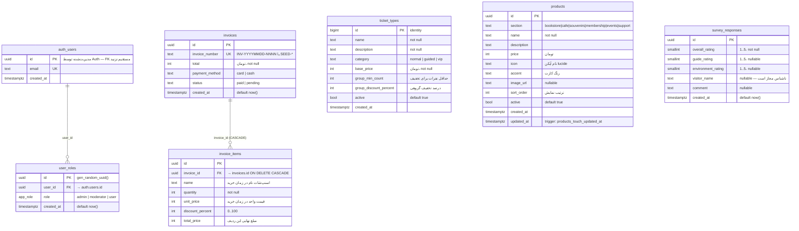

# مستندات دیتابیس — Database Reference

راهنمای کامل ساختار دیتابیس موزهٔ افتخارات کشتی برای توسعه‌دهندگان.
بک‌اند روی Lovable Cloud (Postgres + Auth + RLS) اجرا می‌شود.

---

## ۱. نمای کلی روابط (ERD)



> **چرا FK به `auth.users` نداریم؟** جدول `auth.users` توسط Supabase مدیریت می‌شود
> و افزودن foreign key به آن ممکن است در migrationها و restore مشکل ایجاد کند.
> فقط `user_roles.user_id` مقدار `auth.users.id` را نگه می‌دارد.

---

## ۲. توضیح جدول‌به‌جدول

### `user_roles`
نقش کاربران **حتماً** در جدول جدا نگهداری می‌شود و هرگز روی جدول کاربران/پروفایل.
اگر نقش را روی رکورد کاربر بگذارید، کاربر می‌تواند با یک UPDATE ساده خودش را ادمین کند
(privilege escalation).

- کلید یکتای `(user_id, role)` → یک کاربر می‌تواند چند نقش داشته باشد.
- `app_role` یک enum است: `admin`, `moderator`, `user`.
- برای افزودن مقدار جدید به enum باید یک migration **جداگانه** بنویسید؛
  `ALTER TYPE ... ADD VALUE` نمی‌تواند در همان تراکنشی اجرا شود که از مقدار جدید استفاده می‌کند.

### `ticket_types`
منبع حقیقت انواع بلیط. `group_min_count` و `group_discount_percent` منطق تخفیف
گروهی را داده‌محور می‌کنند — یعنی ادمین بدون تغییر کد می‌تواند قوانین تخفیف را عوض کند.

فرمول:
```text
discount = (quantity >= group_min_count) ? group_discount_percent : 0
total     = round(quantity * base_price * (1 - discount / 100))
```

### `products`
همهٔ شش فروشگاه از یک جدول تغذیه می‌شوند و با ستون `section` از هم جدا می‌شوند.
افزودن یک فروشگاه جدید = یک `section` جدید + یک route جدید. جدول تازه لازم نیست.

`icon` نام یک آیکن از `lucide-react` است و در `SectionShopPage` به‌صورت داینامیک
resolve می‌شود (اگر پیدا نشد `Package` نمایش داده می‌شود).

### `invoices` / `invoice_items`
اقلام فاکتور **اسنپ‌شات** هستند نه رفرنس: `name` و `unit_price` در لحظهٔ خرید کپی
می‌شوند. بنابراین اگر ادمین بعداً قیمت یک محصول را عوض کند، فاکتورهای قدیمی
دست‌نخورده می‌مانند. به همین دلیل هم FK به `products`/`ticket_types` نداریم.

`ON DELETE CASCADE` روی `invoice_id` تضمین می‌کند حذف فاکتور، اقلام یتیم به‌جا نگذارد.

### `survey_responses`
همهٔ ستون‌های امتیاز `smallint` در بازهٔ ۱ تا ۵. `visitor_name` nullable است چون
ثبت ناشناس مجاز است.

---

## ۳. RLS و دسترسی‌ها

| جدول | anon | authenticated | admin | توضیح |
|---|---|---|---|---|
| `ticket_types` | خواندن | خواندن | همه‌کاره | UI فقط `active = true` را نشان می‌دهد |
| `products` | خواندن | خواندن | همه‌کاره | UI با `active = true` فیلتر می‌کند |
| `invoices` | ثبت | ثبت | خواندن همه | بازدیدکننده فقط می‌سازد، نمی‌خواند |
| `invoice_items` | ثبت | ثبت | خواندن همه | همان منطق فاکتور |
| `survey_responses` | ثبت | ثبت | خواندن و حذف | ثبت ناشناس مجاز |
| `user_roles` | — | خواندن ردیف خودش | همه‌کاره | با `has_role()` بررسی می‌شود |

### چرا `has_role()` باید `SECURITY DEFINER` باشد؟

یک policy روی `user_roles` که برای بررسی ادمین‌بودن دوباره از `user_roles` بخواند،
باعث **recursion** می‌شود و Postgres خطا می‌دهد. راه‌حل استاندارد:

```sql
CREATE OR REPLACE FUNCTION public.has_role(_user_id uuid, _role app_role)
RETURNS boolean
LANGUAGE sql STABLE SECURITY DEFINER SET search_path = public
AS $$
  SELECT EXISTS (
    SELECT 1 FROM public.user_roles WHERE user_id = _user_id AND role = _role
  );
$$;
```

`SECURITY DEFINER` تابع را با دسترسی مالک اجرا می‌کند و RLS را دور می‌زند،
`STABLE` اجازهٔ کش‌شدن در یک کوئری را می‌دهد، و `SET search_path = public`
جلوی search_path hijacking را می‌گیرد.

### قانون طلایی GRANT

Supabase به‌صورت پیش‌فرض هیچ دسترسی‌ای روی schema `public` به نقش‌های
`anon` / `authenticated` / `service_role` نمی‌دهد. فعال‌کردن RLS کافی نیست.
هر migration که جدول می‌سازد باید دقیقاً این ترتیب را رعایت کند:

```sql
-- 1
CREATE TABLE public.my_table (...);
-- 2
GRANT SELECT, INSERT, UPDATE, DELETE ON public.my_table TO authenticated;
GRANT ALL ON public.my_table TO service_role;
GRANT SELECT ON public.my_table TO anon;   -- فقط اگر policy خواندن عمومی دارد
-- 3
ALTER TABLE public.my_table ENABLE ROW LEVEL SECURITY;
-- 4
CREATE POLICY "..." ON public.my_table FOR SELECT USING (...);
```

بدون مرحلهٔ ۲ خطای `permission denied for table my_table` می‌گیرید.

---

## ۴. کوئری هر جریان

### ۴.۱ نمایش محصولات یک فروشگاه

```ts
const { data } = await supabase
  .from("products")
  .select("id, section, name, description, price, icon, accent, image_url, active")
  .eq("section", "bookstore")
  .eq("active", true)
  .order("sort_order")
  .order("id");
```

### ۴.۲ ثبت فاکتور خرید (بلیط + محصول)

```ts
const { data: invoice } = await supabase
  .from("invoices")
  .insert({
    invoice_number: `INV-${dateKey}-${rand4}`,
    total,
    payment_method: "card",
    status: "paid",
  })
  .select("id")
  .single();

await supabase.from("invoice_items").insert(
  cartItems.map((i) => ({
    invoice_id: invoice.id,
    name: i.name,
    quantity: i.quantity,
    unit_price: i.unitPrice,
    discount_percent: i.discountPercent,
    total_price: Math.round(i.quantity * i.unitPrice * (1 - i.discountPercent / 100)),
  })),
);
```

> `anon` می‌تواند INSERT کند ولی SELECT نه — بنابراین حتماً `.select("id")` را
> روی همان insert بزنید تا شناسه را برگرداند؛ یک SELECT جداگانه بعداً کار نمی‌کند.

### ۴.۳ ثبت نظرسنجی

```ts
await supabase.from("survey_responses").insert({
  overall_rating: 5,
  guide_rating: 4,
  environment_rating: 5,
  visitor_name: name || null,
  comment: comment || null,
});
```

### ۴.۴ خواندن فاکتور در صفحهٔ موفقیت

فاکتور برای `anon` قابل خواندن نیست؛ صفحهٔ `/checkout/success` خلاصه را از
state سبد/URL می‌گیرد و QR را از `invoice_number` می‌سازد.
لیست کامل فاکتورها فقط در `/admin/invoices` (نقش admin) خوانده می‌شود:

```ts
await supabase
  .from("invoices")
  .select("*, invoice_items(*)")
  .order("created_at", { ascending: false });
```

### ۴.۵ بررسی نقش کاربر

```ts
const { data: isAdmin } = await supabase.rpc("has_role", {
  _user_id: user.id,
  _role: "admin",
});
```

---

## ۵. تریگرها و توابع

| نام | نوع | کارکرد |
|---|---|---|
| `public.has_role(uuid, app_role)` | function, SECURITY DEFINER | بررسی نقش بدون recursion در RLS |
| `public.products_touch_updated_at()` | trigger function | به‌روزرسانی خودکار `products.updated_at` |

---

## ۶. داده‌های نمونه (Seed)

migration با نام `seed_data` این‌ها را می‌سازد و **idempotent** است
(اجرای مجدد داده تکراری نمی‌سازد):

| کاربر تست | رمز | نقش |
|---|---|---|
| `test-user1@museum.local` | `Test@12345` | `user` |
| `test-mod@museum.local` | `Test@12345` | `moderator` |
| `test-admin2@museum.local` | `Test@12345` | `admin` |

به‌علاوه:
- ۸ پاسخ نظرسنجی با امتیاز ۲ تا ۵ و تاریخ‌های پراکنده در ۱۵ روز گذشته
- ۵ فاکتور `SEED-1001` تا `SEED-1005` شامل بلیط عادی، بلیط گروهی با تخفیف ۱۵٪،
  ترکیب بلیط+محصول، خرید یادبود در وضعیت `pending` و عضویت سالانه

پاک کردن داده‌های نمونه:

```sql
DELETE FROM public.invoices WHERE invoice_number LIKE 'SEED-%';   -- items با CASCADE
DELETE FROM public.survey_responses WHERE created_at < now() - interval '16 days';
```

---

## ۷. اشتباهات رایج

| اشتباه | نتیجه | درست |
|---|---|---|
| ساخت جدول بدون `GRANT` | `permission denied for table X` | الگوی چهارمرحله‌ای بخش ۳ |
| ذخیرهٔ نقش روی جدول کاربر | privilege escalation | جدول `user_roles` جدا |
| `has_role` بدون `SECURITY DEFINER` | `infinite recursion detected in policy` | تابع بخش ۳ |
| FK به `products` از `invoice_items` | حذف محصول فاکتور را می‌شکند | اسنپ‌شات نام و قیمت |
| `ALTER TYPE ADD VALUE` هم‌تراکنش با استفاده از مقدار | `unsafe use of new value of enum` | دو migration جدا |
| استفادهٔ `CHECK (created_at < now())` | خطا در restore | تریگر اعتبارسنجی |
